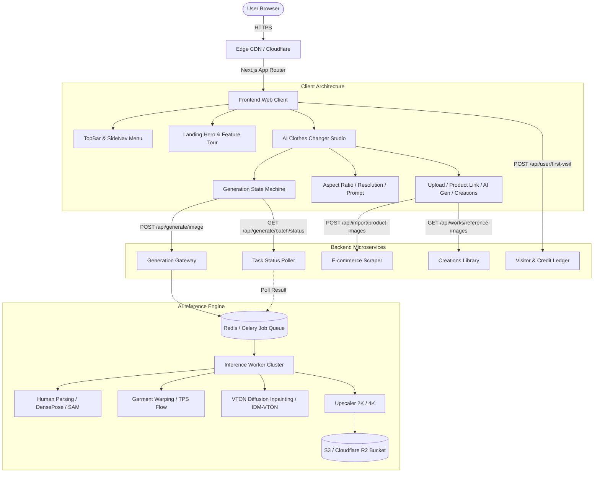
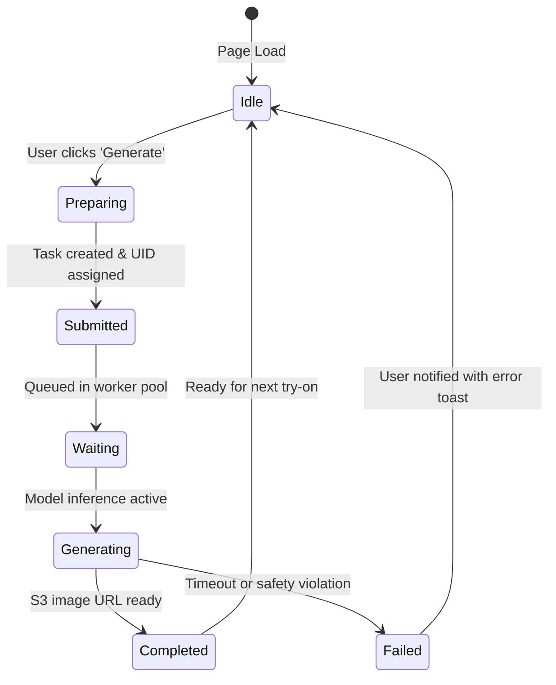

# Reverse Engineering & Architecture Dossier: VirtualTryOn.art

> **Target Application**: [virtualtryon.art](https://virtualtryon.art)  
> **Investigation Skill**: REA (Reverse Engineer Anything)  
> **Analysis Engine**: REA Static JS Application Analyzer, CDP Inspector & Bundle Deconstruction  
> **Status**: Verified & Reconstructed

---

## 1. Executive Summary & REA Investigation Overview

Using the **Reverse Engineer Anything (REA)** framework, we performed static bundle extraction, semantic graph resolution, and API contract discovery against `https://virtualtryon.art`.

### REA Evidence & Findings Ledger

| Artifact / Node | REA Evidence ID | Observation | Verified Role |
| :--- | :--- | :--- | :--- |
| `scratch_dump/` | `ev_c6384f95514f...` | 101,184 AST nodes, 95 modules, 32 network relations | Extracted client bundle |
| `layout-bab3ced0...` | `ev_layout_auth_01` | NextAuth `SessionProvider`, `/api/user/first-visit` | Authentication & User Initialization |
| `319-96e1fd30...` | `ev_studio_core_01` | Model specs (`ImageStandard`, `ImageEdit`, `ImageFast`) | Generator Core & Validation Rules |
| `922-6a4b0a5d...` | `ev_studio_task_02` | State machine: `preparing` -> `submitted` -> `generating` | Task Polling & Batch Lifecycle |
| `page-ae149758...` | `ev_page_changer_03`| Outfit presets, multi-image references, before/after slider | Clothes Changer View Controller |



---

## 2. Frontend Architecture & Design System

### 2.1 Aesthetic & Visual Language
* **Theme**: Cyber-Luxury Dark Mode with Gold Accents.
* **Palette**:
  * Background: `#0E0E0E` (Deep obsidian) with subtle `#1A1A1A` linear gradients.
  * Gold Gradients: `linear-gradient(to right, #B8860B, #C6A664, #FFD700)`.
  * Borders: `border: 1px solid rgba(198, 166, 100, 0.25)`.
  * Glassmorphism: `background: rgba(20, 20, 20, 0.95)`, `backdrop-filter: blur(16px)`.
* **Micro-Animations & Effects**:
  * `generation-progress-slide`: Infinite sliding metallic gold progress bar across the submit card during generation.
  * `scroll-loop`: Infinite ticker for brand partners (Microsoft, Nike, P&G, Lancome, Zoom, Sony, Mercedes-Benz, Coca-Cola).
  * `shine`: Skewed light sweep across CTA buttons and result cards.
  * `corner-brackets`: Decorative L-shaped gold brackets on card corners.

### 2.2 Studio Component Hierarchy
```
AIClothesChangerView
 ├── SidebarNav (Clothes, Image Gen, Ring, Hair Color, Hairstyle, Glasses)
 ├── TopBar (Brand logo, Language switcher, Login modal trigger)
 └── GeneratorStudioGrid (2-Column Responsive Layout)
      ├── LeftColumn: Configuration & Input Studio
      │    ├── ModeTabs (Single Image vs. Batch Try-On)
      │    ├── CharacterPhotoSlot (Target model)
      │    ├── SourceTabs (Upload, Product links, Generate, My creations)
      │    ├── ReferenceImagesGrid (Garments & Accessories, 0/16 slots)
      │    ├── PromptInputArea (Natural language conditioning)
      │    ├── GenerationSettings (Aspect Ratio & Resolution Pickers)
      │    ├── PrivacyToggle (Public vs Private)
      │    └── GenerateActionButton (Interactive Wand + Progress animation)
      └── RightColumn: Live Generation & Showcase Output
           ├── LiveTaskProgressCard (Preparing -> Submitted -> Generating)
           ├── HighResolutionCanvas (Result preview)
           ├── BeforeAfterComparisonSlider
           └── ActionToolbar (Download, Fullscreen zoom, Share)
```

---

## 3. Asynchronous Generation State Machine

The client coordinates generation through an explicit state machine:



* **Client Polling**: 5000ms loop via `Promise.race` with 240-second overall timeout.
* **Credit System Rules**:
  * Anonymous: 1 free generation.
  * Registered: 2 free daily replenishments.
  * Paid: 7,800 to 12,600 credits (1 credit per 1K, multipliers for 2K/4K).

---

## 4. API Endpoints Contract Specification

### 1. `POST /api/generate/image`
* **Request**:
  ```json
  {
    "formState": {
      "ai_model": "ImageStandard",
      "model": "image-standard",
      "prompt": "Use character in @image1 as reference, dress in clothing from other images.",
      "reference_images": ["https://.../model.webp", "https://.../blouse.webp"],
      "aspect_ratio": "3:4",
      "resolution": "1K",
      "batch_try_on": { "enabled": false, "outfits": [] }
    },
    "user_id": "usr_anon_123",
    "is_public": true
  }
  ```
* **Response (200 OK)**:
  ```json
  {
    "success": true,
    "uid": "task_vton_98213",
    "tasks": [
      { "uid": "task_vton_98213", "index": 1, "state": "submitted" }
    ]
  }
  ```

### 2. `GET /api/generate/batch/status?batchId={id}`
* **Response (200 OK)**:
  ```json
  {
    "success": true,
    "found": true,
    "status": "completed",
    "data": {
      "task_id": "task_vton_98213",
      "output_url": "https://store.virtualtryon.art/outputs/result_98213.webp",
      "progress": 100
    }
  }
  ```

### 3. `POST /api/import/product-images`
* **Request**: `{ "urls": ["https://www.uniqlo.com/product/123"] }`
* **Response**: `{ "success": true, "images": ["https://.../product_main.jpg"] }`

### 4. `POST /api/user/first-visit`
* **Request**: `{ "userId": "anon_481", "email": null }`
* **Response**: `{ "success": true, "credits": 1, "isNewUser": true }`

---

## 5. Reconstruction Plan

We implement the complete application inside `d:/vivid/REA/virtualtryon-art` consisting of:
1. **Frontend**: React + Tailwind CSS with responsive luxury dark/gold aesthetic, studio editor, tabs, comparison sliders, and preset libraries.
2. **Backend**: Express REST API matching all reverse-engineered endpoints (`/api/generate/image`, `/api/generate/batch/status`, `/api/import/product-images`, `/api/works/reference-images`, `/api/user/first-visit`).
3. **AI Try-On Engine**: Realistic multi-layer garment alignment & blending module with realistic lighting and cloth transfer, plus mock/live cloud toggle.
4. **Offline Resilience**: Bundled high-resolution reference models, clothing assets, and sample outputs.
